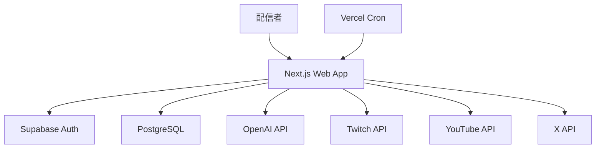

# 僕だけのマネージャー — Public Portfolio

配信活動に必要な分析・タスク管理・スケジュール管理・AI相談をひとつにまとめた、配信者向けWebアプリです。

**公開サイト:** [https://bokumane.com](https://bokumane.com)  
**開発形態:** 個人開発 / プライベートβ

> このリポジトリは採用・ポートフォリオ向けの公開版です。  
> 本番環境のソースコード、認証情報、DB定義、実ユーザーデータは含みません。

## プロダクト概要

個人配信者は、配信そのものに加えてデータ確認、振り返り、企画、タスク、予定まで一人で管理する必要があります。  
「僕だけのマネージャー」は、Twitch・YouTubeの実データとAIを組み合わせ、次に取る行動を判断しやすくすることを目的に開発しています。

## 主な機能

- AIマネージャーによる活動相談
- Twitch OAuth連携と本人チャンネル情報の取得
- 配信中の視聴者数・フォロワー数の定期スナップショット
- 配信ごとの平均・最大視聴者数、フォロワー増減、推移の可視化
- YouTube OAuth連携と動画・配信データの確認
- タスク管理、スケジュール管理、ダッシュボード
- ユーザーごとのAI利用回数・予算制御
- 同意履歴、外部連携解除、アカウント削除

## 担当範囲

個人開発として、以下を一貫して担当しています。

- 要件整理・機能設計
- UI/UX設計・スマートフォン対応
- DB設計・マイグレーション
- Supabase Authを使った認証
- Twitch / YouTube / X OAuth連携
- OpenAI APIを使ったAI機能
- API・セッション・利用制限の設計
- Vercelへのデプロイと運用
- 利用規約・プライバシーポリシー・退会導線の整備

## 技術スタック

| 分類 | 技術 |
| --- | --- |
| フロントエンド | Next.js 16 / React 19 / TypeScript |
| UI | Tailwind CSS 4 / Responsive Design |
| サーバー | Next.js Route Handlers |
| 認証・DB | Supabase Auth / PostgreSQL |
| AI | OpenAI API |
| 外部連携 | Twitch API / YouTube API / X API |
| ホスティング | Vercel |
| 定期処理 | Vercel Cron |

## システム構成

詳細は [アーキテクチャ](docs/architecture.md) を参照してください。

## 技術的な工夫

### 1. 外部アカウントとアプリ利用者の分離

アプリのログインユーザーIDと、Twitch・YouTubeなどの外部アカウントIDを別々に管理しています。OAuthコールバックではstate、Cookie、ログイン中の利用者を照合し、別ユーザーへの誤連携を防ぎます。

### 2. 定期観測データを配信単位へ集約

一定間隔で保存したスナップショットを、観測間隔と配信情報からグループ化します。未観測を0人として扱わず、取得できた値だけから平均・最大・増減を算出します。

### 3. AI利用量の制御

ユーザー単位の月間回数制限に加え、アプリ全体の予算予約・確定処理を実装しています。AI呼び出しが失敗した場合は確保した利用回数を返却します。

### 4. 信頼できない入力への対策

配信タイトルやプロフィールなど、外部サービス由来の文字列をAIへの命令として扱わないようにシステム指示を分離しています。AI出力はJSON形式と型検証を通してから画面に返します。

## セキュリティ方針

- APIキー・OAuthシークレットはサーバー環境変数で管理
- 管理者権限のDBキーをブラウザへ配信しない
- APIごとにログイン本人・所有アカウントを確認
- OAuth stateと短時間Cookieを照合
- 更新系APIでOriginを確認
- PostgreSQL RLSと権限剥奪を併用
- Cronエンドポイントを専用Bearerシークレットで保護
- レスポンスやログへアクセストークンを含めない

詳細は [セキュリティ設計](docs/security.md) を参照してください。

## 公開サンプル

本番固有の情報を取り除いた、設計意図を示すサンプルです。

- [認証付きRoute Handler](examples/authenticated-route.example.ts)
- [配信スナップショット集計](examples/stream-aggregation.example.ts)
- [OAuth stateの署名と検証](examples/oauth-state.example.ts)

## 開発状況

- プライベートβ向け主要機能：実装済み
- PC・スマートフォン実機確認：継続中
- 実配信によるデータ精度検証：継続中

## 公開範囲について

この公開版は、設計・技術選定・実装方針を説明するためのポートフォリオです。  
本番リポジトリとデータベースは非公開で管理しています。

Copyright © 2026. All rights reserved.
