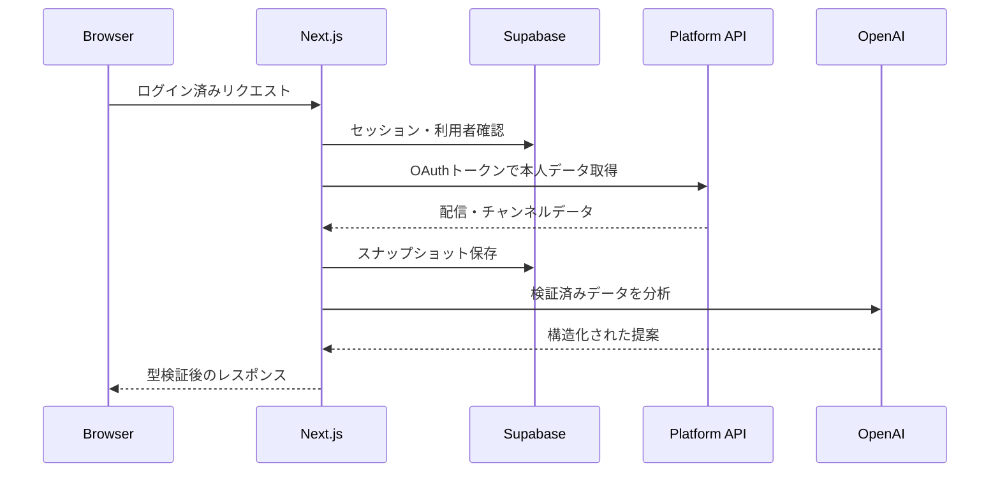

# アーキテクチャ

## 全体像

Next.jsの画面とRoute Handlerを中心に、Supabase、外部プラットフォームAPI、OpenAI APIを接続しています。ブラウザから管理者権限のDBキーやOAuthシークレットを扱わず、外部APIアクセスはサーバー側へ集約しています。

## データの考え方

- アプリ利用者IDをすべての所有データの基準にする
- 外部サービスのアカウントIDは連携テーブルで管理する
- OAuthトークンはサーバーからのみ読み書きする
- 視聴者数・フォロワー数は時系列スナップショットとして保存する
- 集計値だけでなく観測件数・観測期間も表示する
- 未取得と0を区別する

## 定期処理

Vercel Cronから保護されたRoute Handlerを呼び出し、連携済みチャンネルの状態を確認します。配信中のみスナップショットを保存し、同一時刻の重複記録を避けます。

## エラー設計

- 未ログイン、未連携、期限切れ、外部API障害を区別
- 内部エラーの詳細やトークンをクライアントへ返さない
- 外部連携の問題でアプリのログイン状態まで破棄しない
- AI処理失敗時に確保済み利用回数を返却
